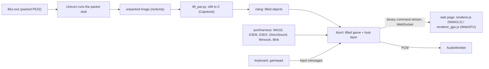

# blur-web

Run Blur (Bizarre Creations, 2010, Direct3D 9, Windows x86) in a web browser tab, from **your own copy of the game**.

The packed `Blur.exe` is booted in an emulator, its unpacked x86 code is statically recompiled ("lifted") to C on your
machine, and that C is linked with a hand-written Win32 / Direct3D 9 / DirectSound / Winsock host layer. The host runs
the game natively and streams the Direct3D draw commands to a WebGL2 (or WebGPU) page, which draws them and plays the
audio. About 60 fps in a race on an Apple M4 Max. It is a personal learning project, not a polished product.

> **Bring your own game.** This repository contains no part of Blur: no executable, no data, no shaders, no lifted
> code, no screenshots. You need a legally obtained copy (retail build, `Blur.exe` with SHA-256
> `7ef92b57bfd8741cf3de44225e3586c99d7365d7e212b86b3229fbb7d99deee9`). Everything that is derived from the game is generated
> on your computer by `setup.sh`, stays there, and must not be published or shared. The MIT licence covers this
> repository's own code only. See [LICENSE](LICENSE) and [NOTICE](NOTICE). The online services of the game no longer exist;
> single player and LAN races work.

## Quickstart

```sh
git clone <this repository> blur-web && cd blur-web
./setup.sh /path/to/your/Blur            # folder that contains Blur.exe (or the path of Blur.exe). Once; see times below
./play.sh                                # starts the host and opens http://127.0.0.1:8765/ in your browser
```

1. **Setup** (once). It installs missing packages with Homebrew/apt (asks first), builds `vkd3d-shader`, boots the game
   in the emulator to dump its unpacked image, lifts that image to C, compiles it and links `port/harness/blurrt`.
   You also need Microsoft's Visual C++ 2008 runtime (`msvcr90.dll` 9.0.21022.8, 32-bit), which is not distributable
   from here: if it is not next to the game, pass it with `--crt /path/to/vcredist_x86.exe` (the Microsoft
   "Visual C++ 2008 Redistributable Package (x86)", needs 7-Zip) or `--crt /path/to/msvcr90.dll`.
2. **Play.** `./play.sh` asks once for the name other players see, skips the first-run "Online Account" dialog and opens
   the page. Click into the page once so the browser allows sound. Use Chrome, Edge or another Chromium based browser.
3. **Stop** with Ctrl+C in the terminal. Saves go to `port/harness/save/`.

The whole setup took 5 min 36 s from a clean clone on an Apple M4 Max (16 cores, 128 GB, macOS), see
[how long setup takes](#how-long-setup-takes). Early in a session the page uses more CPU while it compiles shaders.

## Requirements

| | |
|---|---|
| Game | the retail `Blur.exe` with the SHA-256 above (other builds are refused unless `--force`; the address lists in `port/recomp` are for that build) and the complete install next to it (`cache/`, `levels/`, `UI/` ...) |
| `msvcr90.dll` | 9.0.21022.8 x86 (SHA-256 `ed0170d3...2185`), from the VC++ 2008 redistributable |
| macOS | **Apple silicon is what this was built and tested on** (macOS, Xcode command line tools, Homebrew). Intel Macs: the code is portable but untested |
| Linux | x86-64 and arm64, **best effort and not run end to end here.** `setup.sh` knows apt (Debian/Ubuntu) and builds Unicorn 2.1.4 itself; it follows the Docker recipe in `port/pack/linux` that the original project used to build Linux binaries, but the Linux path of `setup.sh` itself was never executed (no Linux machine or running Docker was available for this repository). Expect to fix small things |
| Windows | **Not supported by `setup.sh`.** Use WSL2 (Ubuntu) and treat it as Linux (untested). A cross-compiled Windows x64 build exists in `port/work/win` (notes inside); it was only smoke-tested under Wine, never on real Windows |
| CPU / RAM / disk | 16 GB RAM recommended (the process reserves 4 GB of address space for the guest and uses 1-2 GB), about 1 GB of disk for the generated code and binaries, plus the game itself. Lifting and compiling use every core |
| Browser | a recent Chromium based browser with WebGL2. WebGPU is optional |
| Tools | `clang` (musttail support), `make`, `curl`, `python3` (3.8+, with venv, must run natively), `pkg-config`, FFmpeg libraries, SPIRV-Cross, Vulkan loader and headers (vkd3d's configure needs them), Unicorn 2.x |

### What was tested

From a clean clone on macOS (Apple silicon, Homebrew): `setup.sh` end to end, `setup.sh --interp-only`, a second `setup.sh`
run (stages are skipped), `play.sh`, the page in headless Chromium (connected, about 60 fps, intro movie rendering) and
`tools/build_shader_cache.sh` (2323 shaders translated, 0 failures; the page loads the cache). **Not tested:** Intel Macs,
the Linux path of `setup.sh`, Windows or WSL2, `--lan` between two physical computers, building the WGSL pack for WebGPU
from scratch, and any game build other than the one named above.

### How long setup takes

Lifting is a parallel Python job and compiling is about 200 big C files; both scale with the number of cores. Measured
from a clean clone on a 16-core Apple M4 Max (macOS, Homebrew packages already installed, the machine doing other
work): 5 min 36 s in total. Of that, building `vkd3d-shader` about 1 minute, the bootstrap build and the image dump
about 20 seconds, lifting 2.5 minutes (373,5xx functions, 540 MB of C), compiling 1.5 minutes, linking a few seconds.
A second clean run while the machine was saturated by other jobs (load average about 65) took 38 minutes in total (lifting alone 20), so the numbers depend strongly on free cores. On a 4-core laptop expect
roughly four times that (not measured). The generated files take about 1 GB: `port/recomp/gen_p2` 540 MB, objects 160 MB,
`blurrt` 130 MB, `third_party` 47 MB. Everything is cached in `.setup/`; delete `.setup/lift.done` or `.setup/compile.done`
to redo a stage.

### Without the lift: interpreter only

`./setup.sh <game> --interp-only` skips lifting and compiling. The game then runs entirely on the small built-in x86
interpreter (`port/work/interp`). That works, but it is a slideshow: in a measured run the first frame appeared after
about 47 seconds and the loading screen ran at about 2 fps after 75 seconds, versus 60 fps in the menus and races
with lifted code. It is useful to check that your machine, game folder and `msvcr90.dll` are fine before waiting for the
full setup. The Unicorn emulator alone is slower still (this is why the project lifts the code).

## Renderers: WebGL2 and WebGPU

The default page uses **WebGL2** and needs nothing else. `./play.sh --webgpu` opens `#gpu=1`: a WebGPU renderer that
falls back to WebGL2 by itself when WebGPU, the texture formats or the shader pack are not available. The WGSL pack
the WebGPU renderer needs is derived from the game's shaders, so it is not in this repository and `setup.sh` does not
build it: see `port/work/webgpu/README.md` (needs `naga-cli`, SPIRV-Tools, brotli; experimental, not exercised by
`setup.sh`). An optional **shader cache** for WebGL2 (`tools/build_shader_cache.sh`, or `./setup.sh <game> --shaders`)
removes most shader-compile hitches; it too is generated from your game files.

Page flags go in the URL hash and can be combined with `&`: `#hud=1` frame-time HUD, `#gpu=1` WebGPU, `#diag=1` draw
statistics, `#glcache=0` turn off the redundant-GL-call filter, `#mirror=full|half|auto`.

## Controls

The game reads the keyboard itself, so its own bindings apply. Defaults seen in its Options screen:
accelerate **Q**, brake/reverse **A**, steer **arrow keys**, handbrake **Down**, fire forward **W**, fire backward **S**,
drop power-up **D**, use power-up **Right Ctrl**, switch power-up **Up**, change view **V**, rear view **Tab**.
Enter confirms and skips cut-scenes, Esc opens the pause menu. A browser-connected gamepad is used through the Gamepad
API. In the page: **F11** or the Fullscreen button, **F2** shows the HUD. On a Mac the key labelled delete works as
Delete. Keys are released when the tab loses focus.

## LAN multiplayer

`./play.sh --lan` runs without any server: each machine broadcasts a HELLO on UDP **47801**, learns the other players
and uses the game's own LAN discovery. Every player runs their own copy of the game (and this repository) on the same
network; allow incoming connections if the firewall asks. In the game: *Multiplayer -> Local Area Network*. Host: press
`=` (or Page Up) and pick a playlist; join: press `-` (or Page Down) to refresh the list, Enter on the game; the host
starts the race with F1. Only one game per computer in this mode. It was verified with two instances on one machine (see the log, section 8); a race between two physical computers is not documented as tested here.
`./play.sh --share` additionally serves the page to other computers (anyone who can reach the port controls your game).
The internet matchmaking of the original game is gone; `port/mp` is an unfinished lobby/WebRTC prototype that is not used.

## Troubleshooting

* **`setup.sh`: different build of Blur.exe** - only the retail build is supported (hash above).
* **msvcr90.dll not found** - see Quickstart step 1. The hash must match, other CRT versions have other code.
* **Setup fails while dumping the image** - look at `.setup/dump-exe.log`. The protector in `Blur.exe` computes jump
  targets from the CPUID of the emulated CPU, so Unicorn **2.x** is required (Debian/Ubuntu packages are 1.x; setup builds
  2.1.4 itself on Linux). Do not substitute another version.
* **`Bad CPU type in executable` (python3)** - the `python3` on your PATH is an Intel build (typical for old pyenv installs)
  on an Apple-silicon Mac without Rosetta. Setup now tries `python3`, Homebrew's and `/usr/bin/python3` and uses the first
  that runs. If none does: `brew install python`.
* **`brew: command not found` over ssh or in a fresh shell** - Homebrew is installed in `/opt/homebrew` but not on PATH.
  Setup finds it by itself; for your own shell add `eval "$(/opt/homebrew/bin/brew shellenv)"` to `~/.zprofile`.
* **`configure: error: libvulkan and libMoltenVK not found` (vkd3d)** - install `vulkan-loader` (`brew install vulkan-loader`).
  Setup installs it for you; older copies of the script did not.
* **brew says "Your Command Line Tools are too outdated"** - update them in System Settings > Software Update (or
  `sudo rm -rf /Library/Developer/CommandLineTools && sudo xcode-select --install`). Prebuilt bottles still install, but
  anything brew has to compile will not.
* **Game stops with `[rt] unsupported at 0040000c` after `[d3dx] constant table limit reached`** - fixed: older builds
  kept every shader constant table forever and ran out after a long session. Pull the latest and run `./setup.sh` again.
* **Copying the game folder to another machine over a flaky link (Tailscale/Wi-Fi)** - use `rsync -a --partial` in a retry
  loop (macOS's built-in rsync has no `--info=progress2`). The folder is about 7.5 GB and must be complete.
* **Page says "disconnected - retrying"** - the host is not running or crashed; look at the terminal. After a rebuild
  hard-reload the page (Cmd/Ctrl+Shift+R).
* **No sound** - click inside the page once; check the browser did not mute the tab. Audio is generated by the game and
  played by an AudioWorklet.
* **Black or washed-out picture** - report it with the `#hud=1` output; try `./play.sh` without `--webgpu`.
* **Slow or stuttering at the start** - shaders are compiled on first use; build the shader cache once
  (`tools/build_shader_cache.sh`). Close other heavy apps: the game uses several threads.
* **`BLUR_G_CHECK` abort / address 0x7000000000 busy** - the guest memory is mapped at a fixed address; another
  library occupying it is rare, restart the machine's offending software or open an issue.
* **Port in use** - `./play.sh` picks the next free port; `--port N` chooses one.
* **Start over** - `rm -rf .setup port/recomp/gen* port/recomp/obj*` and run `./setup.sh` again.

Environment switches (`BLUR_*`) for diagnostics are described in `docs/PLAN_120FPS.md` and in the source next to each
`getenv`. Useful ones: `BLUR_PROF=60` (frame profile), `BLUR_FPSLOG=1`, `BLUR_PAR=0` (not supported by the fast build),
`BLUR_NOSKIP=1` (leave the Online Account dialog alone), `BLUR_KEYS="Enter@L:Event+6s,..."` (scripted keys).

## How it works



* The packer in `Blur.exe` decrypts the image at run time and derives jump targets from CPUID, so an emulator
  (Unicorn 2.x) runs it up to the original entry point. After that the lifted code runs natively.
* The lifter (`port/recomp`, ~900 lines of Python) turns each function into C over a `Cpu` struct. Every call, return
  and indirect jump is a tail call through `rt_dispatch`, so the guest stack alone defines control flow. About 373,500
  functions. Addresses the static pass cannot find are executed by the interpreter (`port/work/interp`) instead of
  stopping the game.
* The image must be read *after* the protector wrote its run-time code, which is why `setup.sh` runs the game for four
  seconds on the interpreter before lifting.
* Guest memory is one 4 GB mapping at the fixed address `0x7000000000`, which lets the compiler fold the base into every
  load and store.
* Windows API calls (`port/harness/hle*.c`, `win.c`, `com.c`), Direct3D 9 (`d3d9.c`, `d3dx.c`) and the rest are
  implemented on the host. D3D9 calls become a compact binary message stream (`gfx.c`); shaders are translated with
  `vkd3d-shader` and SPIRV-Cross (`shadercvt.c`). A content-hash cache avoids resending identical textures.
* Race speed comes from one host thread per guest thread (`BLUR_PAR`), not from the browser.

The full story, with the bugs and what was learned, is in [docs/blur-port-log/index.html](docs/blur-port-log/index.html)
(open it in a browser; screenshots removed), the working notes in [docs/PLAN_120FPS.md](docs/PLAN_120FPS.md) (findings
F1-F159, change log) and [docs/BLUR_WEB_PORT_PLAN.md](docs/BLUR_WEB_PORT_PLAN.md).

## Project layout

```
setup.sh, play.sh          one-time build / start the game
tools/                     build_shader_cache.sh; shot/ = headless-Chromium helpers (cd tools/shot && yarn install)
port/harness/              host runtime in C: PE loader, Win32/D3D9/D3DX/audio/net HLE, scheduler, web server
port/harness/web/          the browser page: index.html, renderer.js (WebGL2), renderer_gpu.js (WebGPU), hcache.js
port/recomp/               the lifter (lift.py, lift_par.py, lift_extra.py), rt.h/rt_vec.c, address lists, oracle tests
port/work/interp/          x86 interpreter used as cold-code fallback, with its Unicorn-based tests
port/work/shader-cache/    shader extraction and offline translation tools
port/work/webgpu/          WGSL pack toolchain for the WebGPU renderer (experimental)
port/work/win/, port/pack/linux/   cross-build notes and recipes for Windows x64 and Linux
port/tools/regress/        smoke walk, deterministic frame-hash and pacing checks (record your own references)
port/mp/                   multiplayer lobby/WebRTC prototype (unused by the game)
port/web/src/              two files the native Makefile still includes (snapshot description)
re/                        Ghidra scripts and Wine probes used while reverse engineering
docs/                      plan, findings log, build log, netcode notes
```

Generated and git-ignored: `game/`, `re/dump/`, `port/vendor/`, `third_party/*`, `port/recomp/gen*`, `port/recomp/obj*`,
`port/harness/blurrt*`, `.setup/`, `.venv/`.

## Contributing (short)

* Keep the repository free of game data: no `Blur.exe`, no dumps, no lifted C, no shaders, no screenshots of the game.
  `.gitignore` covers the usual suspects; check `git status` before committing.
* Use `yarn`, not `npm`, for the JavaScript tools. Do not push generated files.
* Fix game or rendering problems in the native build first (rebuilds take seconds; `port/harness/Makefile`), then in the
  page. The checks live in `port/tools/regress` (smoke walk, frame hashes) and `port/work/interp` (`./run_all.sh`).
* Most "rendering bugs" turned out to be wrong or stubbed Windows/D3D9 calls in the host, not renderer or lifter bugs;
  start by finding the API call (`BLUR_APITRACE`, `BLUR_PROF`) before touching shaders.

## Credits and licence

Written by Krushi Raj Tula as a personal learning project, October 2026; the build log tells how it was done. Blur is (c) Activision / Bizarre Creations.
Third-party software built or linked at setup time: Unicorn Engine, Capstone, vkd3d-shader, SPIRV-Cross, FFmpeg, LLVM/Clang
(see [NOTICE](NOTICE)).

The code in this repository is MIT licensed ([LICENSE](LICENSE)); that does not extend to Blur or to anything
generated from it. Do not redistribute the generated binary: it contains the game's code and links GPL software.
